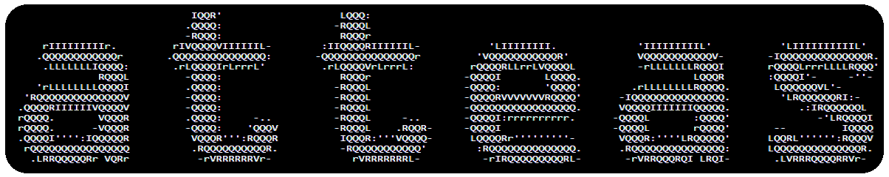

# Hi, my name is Atte
- I program, participate in CTF (Capture The Flag), and model assets and other stuff in Blender in my freetime
- I'm currently a student in an university
- I mainly use C++, JavaScript, Python, Java, and PHP, but also know a bit C, C#, and Rust
- I self-host various projects on my local potato-server
- I'm interested in cybersecurity, web development, self-hosting, Linux, ASCII-art, and making video games
- I'm currently focusing on self-hosting, cybersecurity, and Linux
- I have a website on [atteas](https://atteas.com), which has more information about me, and also my public projects
